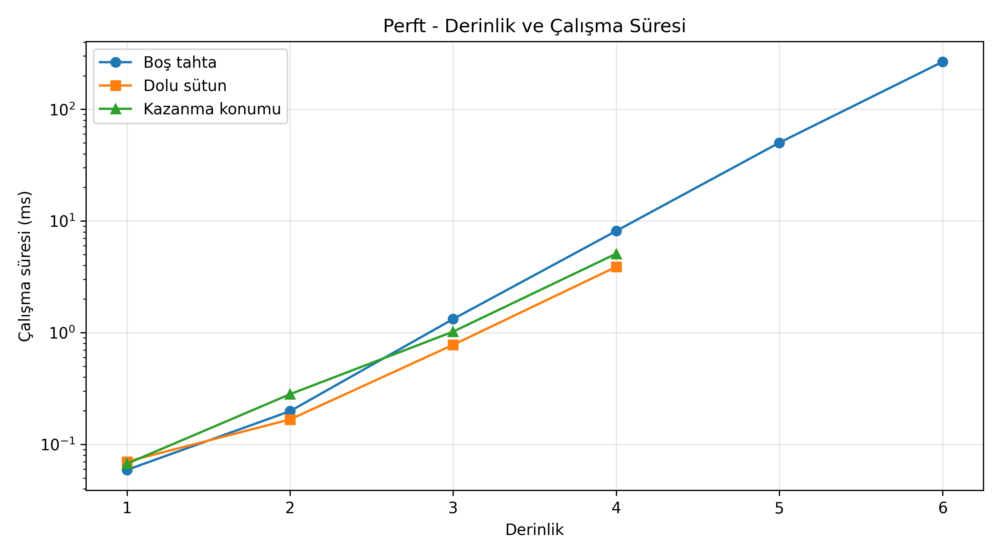
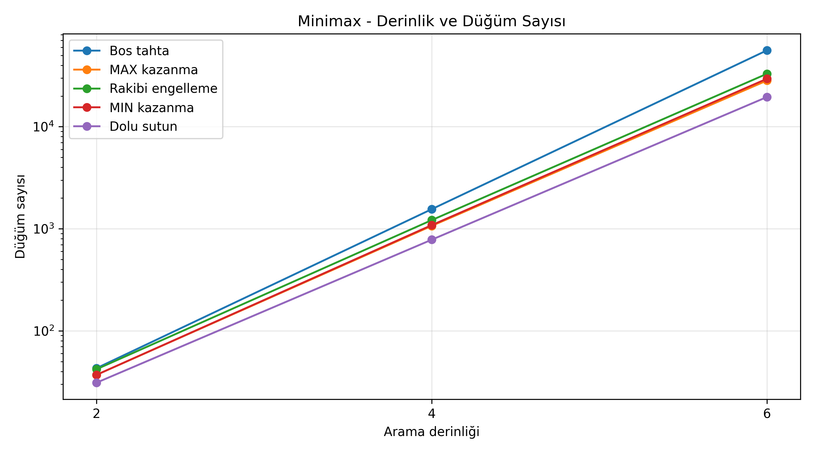
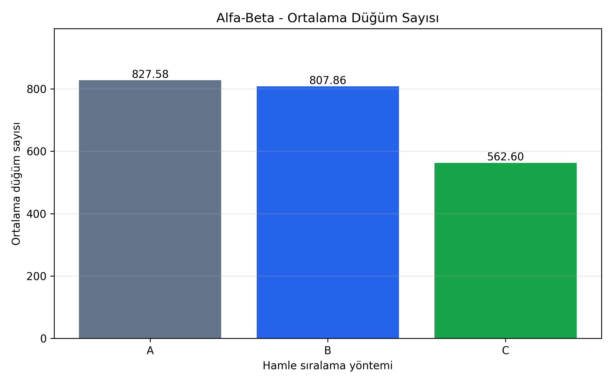
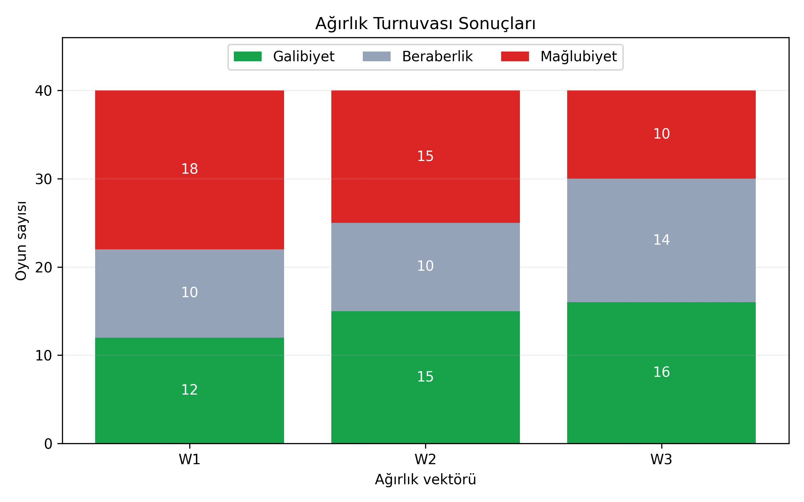
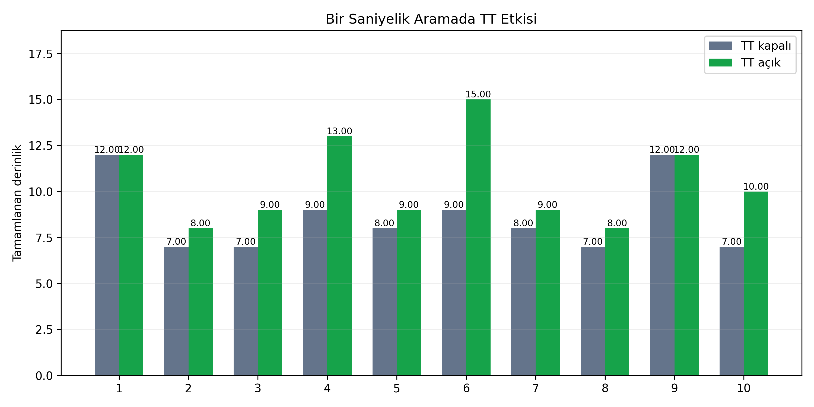

# Connect-K Arena Proje Raporu

**Ders:** Yapay Zekâ
**Öğrenci:** Büşra Okcan
**Öğrenci numarasının son iki hanesi:** 27

## Oyun Varyantı

- R = 5
- C = 6
- K = 5
- V = 1
- d = 27

(R, C, K, V, d) = (5, 6, 5, 1, 27)

Oyun varyantım silindir modelidir. Oyun tahtası
5 satır ve 6 sütundan oluşmaktadır. Kazanmak için
5 taşın yatay, dikey veya çapraz olarak dizilmesi
gerekmektedir. Tahtanın sağ ve sol kenarları
birbirine bağlıdır.

## Aşama 0: Oyun Modeli ve Perft
Oyun modeli iki boyutlu tuple veri yapısı
kullanılarak oluşturuldu. Her hamlede mevcut
tahtayı değiştirmek yerine yeni bir oyun durumu
oluşturuldu.

Silindir varyantında sütunların birbirine
bağlanması modulo işlemiyle sağlandı.
Kazanma kontrolünde son yerleştirilen taşın
yatay, dikey ve iki çapraz doğrultusu incelendi.

### Perft Ölçümleri

| Derinlik | Boş tahta | Dolu sütun | Kazanma konumu |
|---|---:|---:|---:|
| 1 | 6 | 5 | 6 |
| 2 | 36 | 25 | 31 |
| 3 | 216 | 125 | 175 |
| 4 | 1296 | 625 | 882 |
| 5 | 7776 | - | - |
| 6 | 46650 | - | - |

### Perft Çalışma Süreleri (ms)

| Derinlik | Boş tahta | Dolu sütun | Kazanma konumu |
|---|---:|---:|---:|
| 1 | 0.059 | 0.070 | 0.067 |
| 2 | 0.198 | 0.167 | 0.281 |
| 3 | 1.324 | 0.778 | 1.021 |
| 4 | 8.149 | 3.889 | 5.100 |
| 5 | 50.304 | - | - |
| 6 | 266.164 | - | - |

### Sonuçların Değerlendirilmesi

Derinlik arttıkça yaprak sayısının ve çalışma
süresinin arttığı gözlemlendi.

İlk beş derinlikte boş tahta için beklenen
6 üzeri n değerleri elde edildi. Altıncı
derinlikte ise tahta 5 satırlı olduğu için
aynı sütuna altıncı taş yerleştirilemez.
Bu nedenle 46656 yerine 46650 yaprak elde edildi.

Dolu sütun bulunan konumda yasal hamle sayısı
azaldığı için daha az yaprak oluştu.
Kazanma konumunda ise terminal durumlarda
arama durdurulduğu için yaprak sayısı azaldı.

### Birim Testleri

Python unittest kütüphanesi kullanılarak
16 birim testi çalıştırıldı.

- Toplam test: 16
- Başarılı test: 16
- Başarısız test: 0
- Başarı oranı: %100
- Toplam test süresi: 0.335 saniye

Dört oyun varyantına ilişkin hazırlanan testler,
taş yerleştirme, kazanma, beraberlik, geçersiz
hamleler ve Perft kontrolleri başarılı oldu.

## Aşama 1: Minimax
Minimax algoritması max_value(), min_value()
ve choose_move() fonksiyonları kullanılarak
oluşturuldu. Terminal durum kontrolü,
derinlik sınırı kontrolünden önce yapıldı.

Geçici değerlendirme fonksiyonu 0 döndürmektedir.
Eşit değerli hamlelerde merkeze yakın sütunlara
öncelik verilmiştir. Düğüm sayacına kök düğüm
de dahil edilmiştir.

### Minimax Performans Ölçümleri

| Konum | Derinlik | Hamle | Değer | Düğüm | Süre (ms) | b_etkin |
|---|---:|---:|---:|---:|---:|---:|
| Boş tahta | 2 | 2 | 0 | 43 | 0.378 | 6.557 |
| Boş tahta | 4 | 2 | 0 | 1555 | 11.662 | 6.280 |
| Boş tahta | 6 | 2 | 0 | 55981 | 385.038 | 6.185 |
| MAX kazanma | 2 | 0 | 1 | 37 | 0.282 | 6.083 |
| MAX kazanma | 4 | 0 | 1 | 1067 | 8.469 | 5.715 |
| MAX kazanma | 6 | 0 | 1 | 28315 | 206.582 | 5.521 |
| Rakibi engelleme | 2 | 0 | 0 | 42 | 0.325 | 6.481 |
| Rakibi engelleme | 4 | 0 | 0 | 1215 | 8.858 | 5.904 |
| Rakibi engelleme | 6 | 0 | 0 | 32999 | 239.807 | 5.663 |
| MIN kazanma | 2 | 0 | -1 | 37 | 0.513 | 6.083 |
| MIN kazanma | 4 | 0 | -1 | 1085 | 10.062 | 5.739 |
| MIN kazanma | 6 | 0 | -1 | 29490 | 212.767 | 5.558 |
| Dolu sütun | 2 | 2 | 0 | 31 | 0.413 | 5.568 |
| Dolu sütun | 4 | 2 | 0 | 781 | 5.427 | 5.286 |
| Dolu sütun | 6 | 2 | 0 | 19526 | 146.922 | 5.189 |

### Etkin Dallanma Çarpanı ve Yorum

Etkin dallanma çarpanı, düğüm sayısının
1/derinlik kuvveti alınarak hesaplandı.

Boş tahtada derinlik 2 için 43 düğüm ziyaret
edildi. Bu sonuç 1 + 6 + 36 hesabıyla uyumludur.

Derinlik arttıkça düğüm sayısı ve çalışma süresi
artmıştır. Boş tahtada etkin dallanma çarpanı
6 değerine yaklaşırken dolu sütun bulunan
konumda 5 değerine yaklaşmıştır.

Bunun nedeni dolu sütunların yasal hamle
sayısını azaltmasıdır. Kazanma konumlarında
ise terminal kontrolü sayesinde bazı dallar
daha erken sona ermiştir.

Minimax algoritması test edilen konumlarda
kazanma ve rakibi engelleme hamlelerini
doğru şekilde seçmiştir.

### Birim Testleri

- Minimax test sayısı: 10
- Başarılı Minimax testi: 10
- Minimax test süresi: 0.028 saniye
- Toplam birim testi: 26
- Başarısız test: 0
- Toplam test süresi: 0.382 saniye

Not: Ölçümler beş örnek konum üzerinden kendi
bilgisayarımda gerçekleştirilmiştir.
Öğretmenin vereceği konumlar için ölçümler
ayrıca tekrarlanacaktır.

## Aşama 2: Alfa-Beta Budaması ve Hamle Sıralaması

### Yöntem

Minimax algoritmasına alfa ve beta sınırları
eklenerek alfa-beta budaması geliştirildi.

MAX düğümünde value >= beta, MIN düğümünde
value <= alpha koşulu kullanılarak gereksiz
dalların incelenmesi engellendi.

Seed değeri 27 kullanılarak 50 farklı,
terminal olmayan oyun konumu oluşturuldu.
Bunların 25'inde sıra MAX, 25'inde MIN
oyuncusundadır. Konumlar JSON dosyasına
kaydedildi.

### Minimax ve Alfa-Beta Karşılaştırması

| Ölçüm | Minimax | Alfa-Beta (A) |
|---|---:|---:|
| Konum sayısı | 50 | 50 |
| Arama derinliği | 6 | 6 |
| Ortalama düğüm | 31895.22 | 827.58 |
| Ortalama süre (ms) | 257.756 | 7.556 |

50 konumun tamamında kök değerleri eşit
bulundu. Seçilen hamleler düz Minimax ile
doğrulandı. Alfa-beta hiçbir konumda
Minimax'tan daha fazla arama düğümü ziyaret
etmedi.

Konum başına düğüm azalmasının ortalaması
%95.38 olarak hesaplandı.

### Hamle Sıralama Yöntemleri

A: Sütunların doğal sırasıyla incelenmesi.

B: Merkezden dışarı doğru sıralama.

C: Önce kazanma ve rakibi engelleme,
ardından merkezden dışarı doğru sıralama.

Her yöntem aynı 50 konumda derinlik 6
için çalıştırıldı. Toplam 150 alfa-beta
ölçümü yapıldı.

| Ölçüm | A | B | C |
|---|---:|---:|---:|
| Doğruluk | 50/50 | 50/50 | 50/50 |
| Ortalama düğüm | 827.58 | 807.86 | 562.60 |
| Ortalama süre (ms) | 8.511 | 8.822 | 27.500 |
| Sıralama süresi (ms) | 1.743 | 2.160 | 23.040 |
| Ortalama azalma (%) | 95.38 | 94.92 | 97.41 |

### Sonuçların Değerlendirilmesi

Ortalama düğüm sayısında C < B < A
sıralaması elde edildi.

En az düğüm ziyaret eden yöntem C,
en hızlı çalışan yöntem ise A oldu.

C yönteminin daha yavaş olmasının nedeni
kazanma ve engelleme hamlelerini belirlemek
için ek işlemler yapmasıdır.

Silindir varyantında sağ ve sol kenarlar
birbirine bağlı olduğu için merkez sütunların
doğal bir üstünlüğü bulunmamaktadır.

24. konumda A yöntemi 782, B yöntemi
1434, C yöntemi ise 142 düğüm ziyaret etti.
Bu sonuç merkezden dışarı sıralamanın
her zaman avantajlı olmadığını gösterdi.

Sıralama maliyetine yasal hamle listesinin
hazırlanması da dahildir. Süre ölçümleri
zaman sayacının küçük ek maliyetini içerir.

İdeal hamle sıralamasında alfa-beta zaman
karmaşıklığı O(b^(m/2)), en kötü durumda
ise O(b^m) olmaktadır.

### Birim Testleri ve Hata Yakalama

Alfa-beta için 9 yeni birim testi yazıldı.
Toplam birim testi sayısı 35 oldu.

| Beta koşulu | Sonuç |
|---|---|
| value >= beta | 35 test başarılı |
| value > beta | AssertionError: 7 != 2 |
| value <= beta | AssertionError: 0 != 1 |
| Orijinal koşul geri yüklendi | 35 test başarılı |

İlk deneyde eşitlik durumunda budama
yapılmadığı için 2 yerine 7 düğüm ziyaret
edildi.

İkinci deneyde yanlış erken budama
nedeniyle kazanma hamlesi bulunamadı.

Orijinal koşul geri yüklendikten sonra
35 testin tamamı 0.456 saniyede başarıyla
tamamlandı.

Bütün deney ve performans ölçümleri kendi
bilgisayarımda gerçekleştirildi.

## Aşama 3: Sezgisel Değerlendirme Fonksiyonu

### Pencereler ve Öznitelikler

Değerlendirme fonksiyonunda kullanılacak K
uzunluğundaki pencereler önceden hesaplandı.
Böylece her Eval çağrısında pencerelerin yeniden
oluşturulması engellendi.

| Varyant | Pencere sayısı |
|---|---:|
| Standart | 20 |
| Silindir | 48 |
| Misere | 20 |
| Engelli | 8 |

Kendi silindir varyantımda bulunan 48 pencerenin
28 tanesi sarmalıdır.

MAX ve MIN oyuncularının K-1, K-2 ve sarmalı
pencereleri olmak üzere altı öznitelik kullanıldı.
İki oyuncunun da taşını içeren pencereler
değerlendirme dışında bırakıldı.

Merkez sütun kontrolü kullanılmadı çünkü silindir
varyantında sağ ve sol kenarlar birbirine bağlıdır.

### Değerlendirme Yöntemi

Öznitelikler ağırlıkları ile çarpılarak ham puan
hesaplandı. MAX puanları toplandı, MIN puanları
çıkarıldı.

Eval(s) = tanh(Ham Puan / 30)

Terminal olmayan durumların değerleri
-0.999999 ile +0.999999 arasında sınırlandırıldı.
Gerçek kazanma ve kaybetme değerleri korundu.
Terminal kontrolü Eval çağrısından önce yapıldı.

Misere varyantında ham puanın işareti ters çevrildi.
Bu yaklaşımın oyun başarısı henüz ölçülmemiştir.

### Ağırlık Vektörleri

| Öznitelik | W1 | W2 | W3 |
|---|---:|---:|---:|
| max_k1 | 12 | 24 | 10 |
| max_k2 | 3 | 2 | 6 |
| min_k1 | 12 | 24 | 10 |
| min_k2 | 3 | 2 | 6 |
| max_wrap | 2 | 1 | 4 |
| min_wrap | 2 | 1 | 4 |

W1 dengeli, W2 tehdit odaklı, W3 ise gelişim
ve silindir odaklı strateji olarak belirlendi.

Deney öncesinde W3 stratejisinin genel olarak
daha başarılı olabileceği tahmin edildi.

### Ağırlık Turnuvası

Seed 27 ile 10 farklı başlangıç oluşturuldu.
İlk 2-4 hamle rastgele oynatıldı. Her ağırlık çifti
iki farklı oyuncu yönünde 10'ar oyun oynadı.

Bütün ajanlarda derinlik 5 alfa-beta ve A
hamle sıralaması kullanıldı. Toplam 60 oyun
32.626 saniyede tamamlandı.

Galibiyet matrisi:

| Ajan / Rakip | W1 | W2 | W3 |
|---|---:|---:|---:|
| W1 | - | 9 | 3 |
| W2 | 8 | - | 7 |
| W3 | 10 | 6 | - |

Genel sonuçlar:

| Ajan | Galibiyet | Mağlubiyet | Beraberlik | Puan |
|---|---:|---:|---:|---:|
| W3 | 16 | 10 | 14 | 23 |
| W2 | 15 | 15 | 10 | 20 |
| W1 | 12 | 18 | 10 | 17 |

43 oyun galibiyetle, 17 oyun beraberlikle
sonuçlandı. W3 en yüksek puanı elde etti.
Böylece deney öncesindeki tahmin doğrulandı.

Ancak W3, W2 karşısında 6 galibiyet ve
7 mağlubiyet aldı. Bu nedenle W3'ün her rakibe
karşı üstün olduğu söylenemez.

Sonraki aşamada W3 ağırlıkları kullanılacaktır.

### Performans ve Simetri

50 rastgele konumda her ağırlık için 5000,
toplam 15000 Eval çağrısının süresi ölçüldü.

| Ölçüm | W1 | W2 | W3 |
|---|---:|---:|---:|
| Ortalama süre (us) | 21.206 | 21.768 | 22.260 |
| Medyan süre (us) | 21.042 | 21.372 | 21.546 |
| Ayna simetrisi | 50/50 | 50/50 | 50/50 |
| Dönmede aynı | 33 | 33 | 33 |
| Dönmede farklı | 17 | 17 | 17 |

Eval fonksiyonu mikrosaniyeler mertebesinde
çalışmaktadır. Süreler pencere oluşturma
maliyetini içermez.

Ayna simetrisinde 150 kontrolün tamamı başarılıdır.
Silindir tahtanın döndürülmesinde temel öznitelikler
korunmuştur. Ancak sarmalı pencere ağırlığı sabit
sütun sınırına bağlı olduğu için her ağırlıkta
50 konumun 17'sinde Eval değeri değişmiştir.

Bu durum değerlendirme fonksiyonunun döndürme
simetrisi açısından bir sınırlamasıdır.

Engelli varyantta engellerin konumları sabit
olduğundan ayna simetrisi her zaman geçerli değildir.

### Doğruluk Kontrolleri

Yeni Eval fonksiyonuyla Minimax ve alfa-beta
aynı arama derinliğinde eşit kök değerleri verdi.
Önceki değerlendirme seçeneği de korundu.

Toplam 63 birim testi 0.618 saniyede başarılı
oldu.

Bütün oyunlar ve performans ölçümleri kendi
bilgisayarımda gerçekleştirildi.

## Aşama 4: Zaman Sınırlı Arama

### İteratif Derinleşme

Arama derinliği 1'den başlayarak kademeli
olarak artırıldı. Süre dolduğunda yarım kalan
iterasyon iptal edildi ve son tamamlanan
iterasyonun hamlesi korundu.

Önceki en iyi hamle sonraki iterasyonda ilk
sıraya alındı. Bir saniyelik süre sınırı için
100 ms güvenlik payı bırakıldı.

İlk dört konumda ortalama 8.25 derinliğe
ulaşıldı. En uzun arama 0.919702 saniye sürdü.

### Zobrist Hashing

Seed 27 kullanılarak her hücre ve taş türü
için 64 bitlik rastgele anahtar üretildi.
Oyuncu sırası ve engelli hücreler de hash
hesabına dahil edildi.

Artımlı hash hesaplamasında yalnızca yeni
eklenen taş ve oyuncu sırası güncellendi.

Tam hash O(R*C), artımlı hash O(1) zaman
karmaşıklığına sahiptir.

40 rastgele oyunda toplam 1048 hamlenin
hash değeri başarıyla doğrulandı.

| Varyant | Tam hash (us) | Artımlı hash (us) | Hızlanma |
|---|---:|---:|---:|
| Standart | 2.917284 | 0.221702 | 13.159 |
| Silindir | 2.544398 | 0.227359 | 11.191 |
| Misere | 2.824080 | 0.211604 | 13.346 |
| Engelli | 2.251409 | 0.216142 | 10.416 |

Kendi silindir varyantımda hash hesaplama
süresi yaklaşık 11.19 kat hızlandı.
Bu sonuç tüm aramanın hızlanma oranı değildir.

### Transposition Table

Zobrist anahtarları kullanılarak daha önce
araştırılan konumların sonuçları saklandı.

Tabloda derinlik, değer, EXACT/LOWER/UPPER
bayrağı ve en iyi hamle bilgisi tutuldu.

Hash çakışmalarına karşı tahta ve oyuncu
bilgileri karşılaştırıldı.

Sabit derinlik doğruluğunu korumak için
yalnızca aynı derinlikteki kayıtlı değerler
doğrudan kullanıldı. Diğer derinliklerdeki
kayıtlar hamle sıralamasında kullanıldı.

50 rastgele konum eski Eval ve W3 Eval
ile test edildi. Toplam 100 doğruluk
karşılaştırmasının tamamı başarılı oldu.

| Ölçüm | Eski Eval | W3 Eval |
|---|---:|---:|
| TT kapalı düğüm | 827.58 | 3441 |
| TT açık düğüm | 579.18 | 2265.66 |
| Ortalama düğüm azalması (%) | 29.71 | 31.51 |
| TT kapalı süre (ms) | 7.934 | 83.620 |
| TT açık süre (ms) | 6.218 | 48.121 |

### Bir Saniyelik TT Karşılaştırması

10 konumda TT açık ve kapalı olmak üzere
toplam 20 zaman sınırlı arama yapıldı.

| Ölçüm | TT kapalı | TT açık |
|---|---:|---:|
| Ortalama derinlik | 8.6 | 10.5 |
| Ortalama düğüm | 38465.10 | 32327.80 |
| Ortalama süre (s) | 0.851889 | 0.672325 |
| En uzun süre (s) | 0.920616 | 0.918995 |

TT açıkken 8 konumda daha yüksek derinliğe
ulaşıldı. İki konumda derinlik değişmedi.
Hiçbir arama bir saniyeyi aşmadı.

### Ufuk Etkisi ve Tehdit Uzatma

Farklı derinliklerdeki iki ajan karşılıklı
oynatıldı. İkinci oyunda ufuk etkisine
neden olan bir konum bulundu.

Derinlik 1'de MIN oyuncusu 5 numaralı
sütunu seçti. MAX aynı sütuna taş bırakarak
sarmalı çapraz kazanma dizisini tamamladı.

Derinlik 2'de arama 3 numaralı sütunu
seçerek doğrudan kaybı önledi.

Tehdit uzatma yöntemiyle derinlik sınırında
bir hamlelik kazanma tehditleri kontrol
edildi. Gerekli durumlarda arama uzatıldı.

| Derinlik | Normal hamle | Uzatmalı hamle | Normal düğüm | Uzatmalı düğüm |
|---|---:|---:|---:|---:|
| 1 | 5 | 3 | 5 | 9 |
| 2 | 3 | 3 | 21 | 42 |
| 3 | 3 | 3 | 68 | 148 |
| 4 | 3 | 3 | 189 | 401 |
| 5 | 3 | 3 | 407 | 765 |

Tehdit uzatma doğrudan kaybettiren hamleyi
önledi ancak ek işlem maliyeti oluşturdu.

Tam derinlikte yapılan sonraki aramada bu
konumun MIN için zorunlu kayıp olduğu görüldü.
Dolayısıyla uzatma yöntemi nihai kaybı değil,
erken yapılan taktik hatayı önlemiştir.

### Son Performans ve Doğruluk Kontrolleri

15 oyun konumunda normal TT ve tehdit
uzatmalı arama karşılaştırıldı. İki yöntemde
de zaman kontrol aralığı 100 düğüm seçildi.

| Ölçüm | Normal TT | Tehdit uzatma |
|---|---:|---:|
| Başarılı arama | 15/15 | 15/15 |
| Ortalama derinlik | 9.8 | 8.8 |
| Ortalama düğüm | 29694.40 | 14621.73 |
| Ortalama süre (s) | 0.688635 | 0.735628 |
| En uzun süre (s) | 0.902809 | 0.906333 |

7x8 boyutundaki tahtada dört farklı
varyant başarıyla test edildi.

Toplam 30 aramanın hiçbirinde bir saniyelik
süre sınırı aşılmadı. Bu ölçüm sonuçları
bütün olası konumlar için kesin süre
garantisi anlamına gelmemektedir.

97 birim testinin tamamı 0.971 saniyede
başarılı oldu.

Normal TT ajanı ulaştığı ortalama arama
derinliği nedeniyle turnuva için başlangıç
tercihi olarak belirlendi. Tehdit uzatmalı
ajan alternatif olarak korundu.

Bütün deneyler kendi bilgisayarımda
gerçekleştirildi.

## Aşama 5: Turnuva ve Yenilgi Analizi

## Sonuç