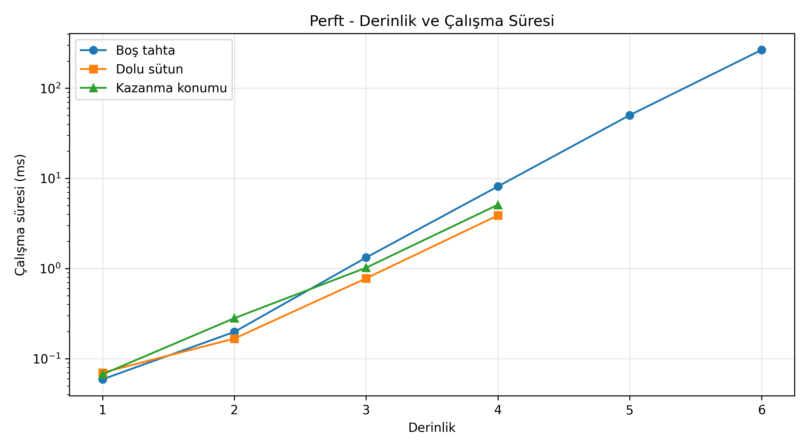
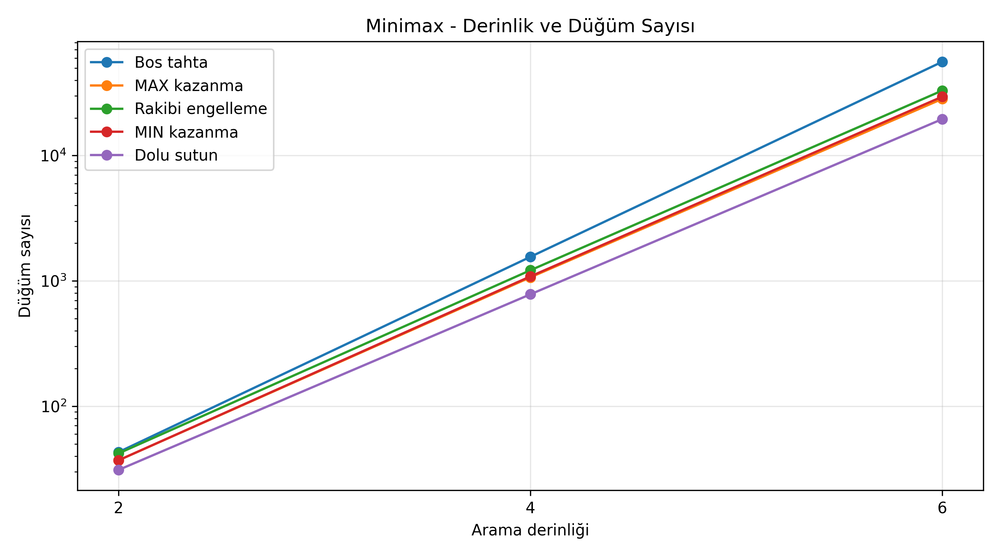

# Connect-K Arena Proje Raporu

**Ders:** Yapay Zekâ
**Öğrenci:** Büşra Okcan
**Öğrenci numarasının son iki hanesi:** 27

## Oyun Varyantı

- R = 5
- C = 6
- K = 5
- V = 1
- d = 27

(R, C, K, V, d) = (5, 6, 5, 1, 27)

Oyun varyantım silindir modelidir. Oyun tahtası
5 satır ve 6 sütundan oluşmaktadır. Kazanmak için
5 taşın yatay, dikey veya çapraz olarak dizilmesi
gerekmektedir. Tahtanın sağ ve sol kenarları
birbirine bağlıdır.

## Aşama 0: Oyun Modeli ve Perft
Oyun modeli iki boyutlu tuple veri yapısı
kullanılarak oluşturuldu. Her hamlede mevcut
tahtayı değiştirmek yerine yeni bir oyun durumu
oluşturuldu.

Silindir varyantında sütunların birbirine
bağlanması modulo işlemiyle sağlandı.
Kazanma kontrolünde son yerleştirilen taşın
yatay, dikey ve iki çapraz doğrultusu incelendi.

### Perft Ölçümleri

| Derinlik | Boş tahta | Dolu sütun | Kazanma konumu |
|---|---:|---:|---:|
| 1 | 6 | 5 | 6 |
| 2 | 36 | 25 | 31 |
| 3 | 216 | 125 | 175 |
| 4 | 1296 | 625 | 882 |
| 5 | 7776 | - | - |
| 6 | 46650 | - | - |

### Perft Çalışma Süreleri (ms)

| Derinlik | Boş tahta | Dolu sütun | Kazanma konumu |
|---|---:|---:|---:|
| 1 | 0.059 | 0.070 | 0.067 |
| 2 | 0.198 | 0.167 | 0.281 |
| 3 | 1.324 | 0.778 | 1.021 |
| 4 | 8.149 | 3.889 | 5.100 |
| 5 | 50.304 | - | - |
| 6 | 266.164 | - | - |

### Sonuçların Değerlendirilmesi

Derinlik arttıkça yaprak sayısının ve çalışma
süresinin arttığı gözlemlendi.

İlk beş derinlikte boş tahta için beklenen
6 üzeri n değerleri elde edildi. Altıncı
derinlikte ise tahta 5 satırlı olduğu için
aynı sütuna altıncı taş yerleştirilemez.
Bu nedenle 46656 yerine 46650 yaprak elde edildi.

Dolu sütun bulunan konumda yasal hamle sayısı
azaldığı için daha az yaprak oluştu.
Kazanma konumunda ise terminal durumlarda
arama durdurulduğu için yaprak sayısı azaldı.

### Birim Testleri

Python unittest kütüphanesi kullanılarak
16 birim testi çalıştırıldı.

- Toplam test: 16
- Başarılı test: 16
- Başarısız test: 0
- Başarı oranı: %100
- Toplam test süresi: 0.335 saniye

Dört oyun varyantına ilişkin hazırlanan testler,
taş yerleştirme, kazanma, beraberlik, geçersiz
hamleler ve Perft kontrolleri başarılı oldu.

## Aşama 1: Minimax
Minimax algoritması max_value(), min_value()
ve choose_move() fonksiyonları kullanılarak
oluşturuldu. Terminal durum kontrolü,
derinlik sınırı kontrolünden önce yapıldı.

Geçici değerlendirme fonksiyonu 0 döndürmektedir.
Eşit değerli hamlelerde merkeze yakın sütunlara
öncelik verilmiştir. Düğüm sayacına kök düğüm
de dahil edilmiştir.

### Minimax Performans Ölçümleri

| Konum | Derinlik | Hamle | Değer | Düğüm | Süre (ms) | b_etkin |
|---|---:|---:|---:|---:|---:|---:|
| Boş tahta | 2 | 2 | 0 | 43 | 0.378 | 6.557 |
| Boş tahta | 4 | 2 | 0 | 1555 | 11.662 | 6.280 |
| Boş tahta | 6 | 2 | 0 | 55981 | 385.038 | 6.185 |
| MAX kazanma | 2 | 0 | 1 | 37 | 0.282 | 6.083 |
| MAX kazanma | 4 | 0 | 1 | 1067 | 8.469 | 5.715 |
| MAX kazanma | 6 | 0 | 1 | 28315 | 206.582 | 5.521 |
| Rakibi engelleme | 2 | 0 | 0 | 42 | 0.325 | 6.481 |
| Rakibi engelleme | 4 | 0 | 0 | 1215 | 8.858 | 5.904 |
| Rakibi engelleme | 6 | 0 | 0 | 32999 | 239.807 | 5.663 |
| MIN kazanma | 2 | 0 | -1 | 37 | 0.513 | 6.083 |
| MIN kazanma | 4 | 0 | -1 | 1085 | 10.062 | 5.739 |
| MIN kazanma | 6 | 0 | -1 | 29490 | 212.767 | 5.558 |
| Dolu sütun | 2 | 2 | 0 | 31 | 0.413 | 5.568 |
| Dolu sütun | 4 | 2 | 0 | 781 | 5.427 | 5.286 |
| Dolu sütun | 6 | 2 | 0 | 19526 | 146.922 | 5.189 |

### Etkin Dallanma Çarpanı ve Yorum

Etkin dallanma çarpanı, düğüm sayısının
1/derinlik kuvveti alınarak hesaplandı.

Boş tahtada derinlik 2 için 43 düğüm ziyaret
edildi. Bu sonuç 1 + 6 + 36 hesabıyla uyumludur.

Derinlik arttıkça düğüm sayısı ve çalışma süresi
artmıştır. Boş tahtada etkin dallanma çarpanı
6 değerine yaklaşırken dolu sütun bulunan
konumda 5 değerine yaklaşmıştır.

Bunun nedeni dolu sütunların yasal hamle
sayısını azaltmasıdır. Kazanma konumlarında
ise terminal kontrolü sayesinde bazı dallar
daha erken sona ermiştir.

Minimax algoritması test edilen konumlarda
kazanma ve rakibi engelleme hamlelerini
doğru şekilde seçmiştir.

### Birim Testleri

- Minimax test sayısı: 10
- Başarılı Minimax testi: 10
- Minimax test süresi: 0.028 saniye
- Toplam birim testi: 26
- Başarısız test: 0
- Toplam test süresi: 0.382 saniye

Not: Ölçümler beş örnek konum üzerinden kendi
bilgisayarımda gerçekleştirilmiştir.
Öğretmenin vereceği konumlar için ölçümler
ayrıca tekrarlanacaktır.

## Aşama 2: Alfa-Beta Budaması ve Hamle Sıralaması

## Aşama 3: Değerlendirme Fonksiyonu ve Ağırlık Ayarı

## Aşama 4: Zaman Sınırlı Arama ve Ufuk Etkisi

## Aşama 5: Turnuva ve Yenilgi Analizi

## Sonuç